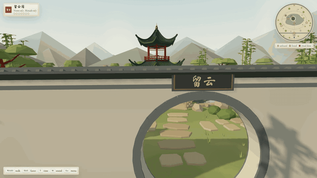
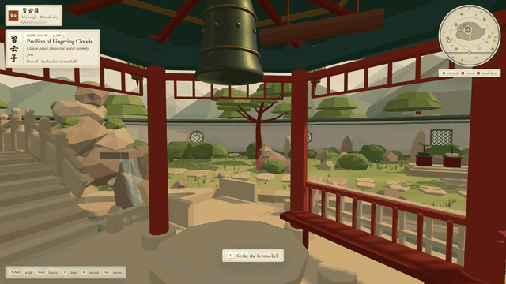
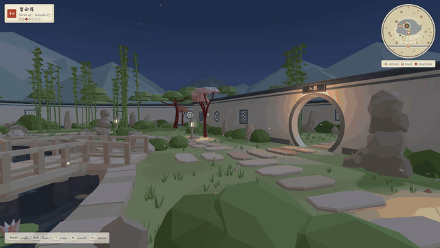

# The Garden of Lingering Clouds · 留云园

A small classical Chinese garden you can walk through on desktop, phone or VR headset.
Built entirely in code with the [Immersive Web SDK (IWSDK)](https://iwsdk.dev) and Three.js.
There are no models to download: every pavilion beam, rock and bamboo leaf is generated
procedurally when the page loads.

Pass through the moon gate, cross the nine-turn bridge to the red pavilion, and find all
seven scenic views. Each view has a small ritual. When all seven are done the garden
lights up for a finale.

**[Walk the garden →](https://felixtrz.github.io/chinese-garden/)**

<p align="center"></p>
<p align="center">
  
  
</p>

The garden started from this [concept art](https://felixtrz.github.io/chinese-garden/concept.png).

## The seven views

| View | Where | Ritual |
| --- | --- | --- |
| 月洞门 Moon Gate | the round doorway in the white screen wall | read the inscription (and its partner on the other side) |
| 九曲桥 Nine-Turn Bridge | the zig-zag bridge to the pavilion | float a lotus lantern, which glows after dusk |
| 留云亭 Pavilion of Lingering Clouds | the pavilion in the pond | strike the bronze bell; strike again as it fades for a harmony |
| 月影桥 Moon-Shadow Bridge | the arched stone bridge | feed the koi, which start to follow you after a few feedings |
| 叠石飞泉 Rockery Cascade | the pavilion's north-west balcony | toss a coin, aiming for the ring beneath the falls |
| 听竹径 Listening-Bamboo Path | the eastern grove | listen to the wind |
| 松风台 Pine-Breeze Terrace | the west terrace | sit and rest under the old pine |

Around them: a 60-second day–dusk–night cycle, koi, plum petals, dragonflies, fireflies,
a reflecting pond, a wind bell and a fully procedural soundscape (Web Audio, no samples).

## Controls

| | Desktop | Phone | VR (Quest etc.) |
| --- | --- | --- | --- |
| Move | `W` `A` `S` `D` (hold `Shift` to stroll faster) | left-thumb joystick | thumbstick locomotion |
| Look | mouse (pointer lock) or drag | drag with the right thumb | your head |
| Ritual | `E` | the red seal button | `A` on the right controller |
| Time of day | `T` (cycle → day → dusk → night) | the time button | `B` on the right controller |
| Sound / hints / menu | `M` / `H` / `Esc` | the menu button | – |

## Running it

Requires Node.js 20.19+, 22.12+ or 24+.

```sh
npm install
npm run dev
```

`npm run dev` starts the IWSDK-managed dev server at `https://localhost:8642` and opens a
browser window that can switch between the running garden and the IWSDK scene editor.
It uses a local development certificate, so accept the browser's certificate warning.
To try it in a headset, open the network URL printed by `npx @iwsdk/cli dev status` from a
headset on the same Wi-Fi. A browser without WebXR runs the same experience with mouse,
keyboard or touch. Without a headset, the managed browser's IWER emulator (IWSDK's
in-browser WebXR emulator) can enter VR; see
[Testing your experience](https://iwsdk.dev/guides/02-testing-experience.html).

| Script | What it does |
| --- | --- |
| `npm run dev` | managed dev server and browser (`dev:status`, `dev:down` to inspect or stop it) |
| `npm run dev:runtime` | plain Vite dev server, no managed browser |
| `npm run typecheck` | `tsc --noEmit`; run this before testing |
| `npm run build` / `npm run preview` | production build to `dist/` and serve it at `https://localhost:8643` |
| `npm run smoke` | end-to-end test against `preview`: visits and completes all seven rituals |
| `npm run capture` | screenshot tour of the garden into `shots/` |

## How it is built

IWSDK projects are declared rather than hand-wired:

- **`iwsdk.config.json`** is the project's source of truth. It selects the scene,
  the asset and component modules, and the world features: VR with hand tracking,
  locomotion with browser controls, and no physics or grabbing.
- **`public/scenes/main.iwsdk.scene.json`** composes the scene from two manifest assets,
  the visible `garden` and an invisible, simplified `garden-collider`. The collider carries
  `LocomotionEnvironment`, so IWSDK's locomotion walks on it and you never fall through
  the pond. The scene also holds the seven scenic views as group nodes carrying the app's
  `PointOfInterest` component.
- **`src/components.ts`** registers that component with `defineComponents()`. The editor
  reads the same manifest, so in the IWSDK editor you can select a view, drag it and tune
  its radius and facing rule in the inspector.
- **`src/assets.ts`** registers those assets with `defineAssets()`. Each one is a
  *scene asset* (`src/scene-assets/*.scene-asset.ts`): a deterministic, side-effect-free
  function that returns a parentless `Object3D`. The same module runs in the app and in the
  IWSDK editor, so it must not touch the DOM, timers or `Math.random`.
- **`src/index.ts`** creates the `World` from the `virtual:iwsdk-project` options and
  registers the app's systems.

```
src/
  index.ts                 World.create() + system registration, DOM HUD wiring
  assets.ts                defineAssets(): garden + garden-collider
  components.ts            defineComponents(): PointOfInterest
  components/              component declarations (no system or DOM imports)
  scene-assets/            the two scene assets
  garden/                  procedural geometry, all deterministic (seeded PRNG)
    layout.ts              the plan: pond outline, bridges, paths, plantings, view texts
    terrain.ts pavilion.ts bridges.ts flora.ts structures.ts
    collider.ts            simplified walkable/blocking geometry for locomotion
    palette.ts util.ts     materials, wind shader patch, geometry batching
  runtime/                 everything that only runs in the app
    player.ts              PlayerSystem: first-person look, gait; queries the views for
                           discovery and rituals
    life.ts                GardenLifeSystem: koi, petals, insects, day/night cycle
    resolution.ts          AdaptiveResolutionSystem: holds ~60 fps in the flat view
    environment.ts         sky, lights, shadows, reflective pond, plaques
    effects.ts audio.ts    pooled visual effects, procedural Web Audio
    hud.ts touch.ts        DOM HUD, minimap and touch controls
    state.ts               state shared by the systems, HUD and tools
tools/                     Playwright scripts that drive the app (see below)
```

A few patterns worth borrowing:

- **Static geometry is batched at build time.** `Batch` in `src/garden/util.ts` merges
  the many small procedural parts into one mesh per material. The garden then freezes
  its matrices (`matrixAutoUpdate = false`) so per-frame scene-graph cost stays small.
- **No allocation in `update()`.** Systems keep scratch vectors, quaternions and typed
  arrays as fields. The 72–90 fps budget in VR leaves no room for garbage-collection
  pauses.
- **Data in the scene, behaviour in systems.** Each view's placement is component data on a
  scene node. The view's text comes from a catalog keyed by the same id. `PlayerSystem`
  declares a `views` query and keeps a cache in sync through its `qualify` and `disqualify`
  subscriptions. Moving a view is therefore a scene edit, not a code change.
- **IWSDK signals for session state.** `PlayerSystem` subscribes to `visibilityState` to
  hide the DOM HUD in the headset and pause on exit, and registers the teardown in
  `cleanupFuncs`, as it does for its listeners and pending timers.
- **One collider, many inputs.** Keyboard, the touch joystick, XR thumbsticks and the
  scripted video capture all move the player through IWSDK's `LocomotionSystem`, so
  collision behaves the same everywhere.

Not everything is an entity, on purpose. The garden is one merged static asset, so its
lantern anchors and wind bell are found once by name rather than made into entities, which
would re-parent them out of the hierarchy that positions them. Koi, petals, fireflies and
coins are pooled instanced meshes animated in tight loops, where one entity per petal
would cost more than it buys. State that several systems and the HUD read, such as the
time of day and ritual progress, lives in one small shared object (`G`).

## Tools

The scripts in `tools/` drive the running app with Playwright through debug hooks
(`window.__garden`). The hooks are exposed on the dev server and, in production builds,
only with `?debug` or `?capture` in the URL. Start `npm run preview` first, or point
`GARDEN_URL` at the dev server. On macOS they use the GPU through Metal. Elsewhere they
fall back to SwiftShader software rendering, which works without a GPU but is slow.

| Script | Purpose |
| --- | --- |
| `smoke.mjs` | completes all seven rituals on a fake clock stepped at 30 fps, so it is deterministic even without a GPU; exits non-zero on failure or page errors |
| `capture.mjs` | screenshot tour plus console log |
| `mobile.mjs` | phone emulation: joystick, look-drag and portrait layout |
| `perf.mjs` | uncapped frame-time benchmark at several views, day and night (GPU only) |
| `video2.mjs` | deterministic one-minute tour video: frame-stepped with a fake clock, so the output is perfectly smooth at any render speed |
| `soundtrack.mjs` | renders that video's soundtrack offline from the capture's event log |
| `render-social.sh` | all three social-media cuts with soundtrack, resumable (needs `ffmpeg`) |
| `sheet.sh` | contact sheet from a folder of screenshots (needs `ffmpeg`) |

`render-social.sh` renders the tour at 30 fps in 3:4 (1080×1440), 4:5 (1080×1350) and
16:9 (1920×1080), each muxed with its soundtrack into `video/social/*.mp4`. It is
resumable: the capture is deterministic, so an interrupted run replays to its last saved
frame and continues. A single format by hand:

```sh
npm run build && npm run preview   # in another terminal
FPS=30 WIDTH=1080 HEIGHT=1440 node tools/video2.mjs video/3x4/frames
node tools/soundtrack.mjs video/3x4/events.json video/3x4/soundtrack.wav 60
ffmpeg -framerate 30 -i video/3x4/frames/%05d.png -i video/3x4/soundtrack.wav \
  -c:v libx264 -crf 18 -pix_fmt yuv420p -c:a aac -shortest -movflags +faststart garden-3x4.mp4
```

## Working on it with AI coding agents

The repository includes the IWSDK project guidance (`AGENTS.md`, `CLAUDE.md`) and agent
skills and rules (`.claude/`, `.agents/`, `.cursor/`, `.github/instructions/`) generated
by the IWSDK project template. They teach coding agents the project's conventions and
the IWSDK CLI, which can screenshot, inspect the ECS and drive an emulated headset.

## Licence

Code: [MIT](LICENSE). The calligraphy font is a subset of Ma Shan Zheng under the SIL
Open Font License; see [THIRD_PARTY_NOTICES.md](THIRD_PARTY_NOTICES.md).
